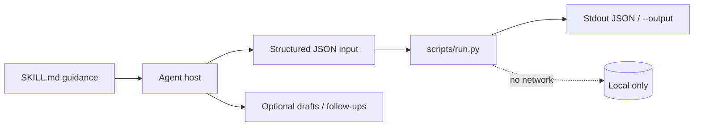
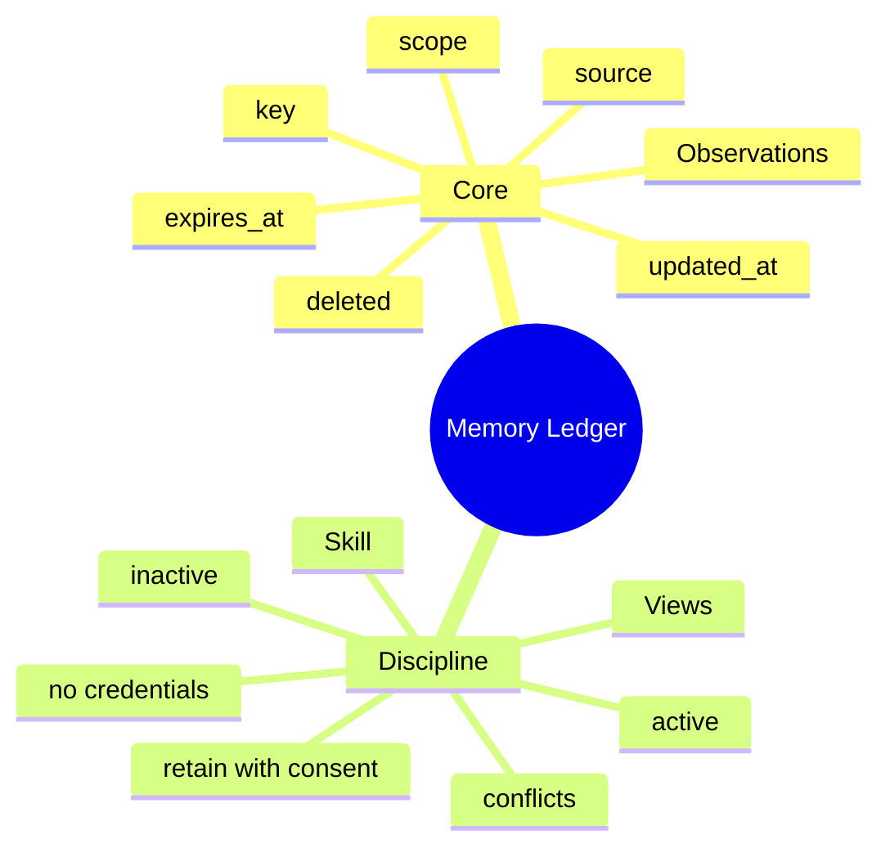

# Memory Ledger

[English](README.md) · [中文](README.zh-CN.md) · **v0.2.1**

[](https://github.com/KarmenLoop/skill-memory-ledger/actions/workflows/checks.yml)
[](https://github.com/KarmenLoop/skill-memory-ledger/releases/latest)
[](https://www.python.org/downloads/)
[](LICENSE)
[](docs/COMPATIBILITY.md)

**Resolve scoped facts at a point in time—with corrections, conflicts, expiry, and deletion still visible.**

An agent skill plus a local reconciler for source-linked observations: active keys, conflicts, and inactive records stay distinct. You keep the export (or transcript, diff, ledger, event log, or JUnit XML) local; the helper stays on the standard library and never opens a network connection. The skill layer teaches a host *when* to prepare input, *how* to narrate results, and *where* to stop before side effects the user did not authorize.

Built and maintained by [KarmenLoop](https://github.com/KarmenLoop) / [KARMENLOOP](https://karmenloop.com). Current release: **[v0.2.1](https://github.com/KarmenLoop/skill-memory-ledger/releases/tag/v0.2.1)**. License: **MIT**.


*Actual local output from v0.2.1, rendered as an image. [examples/expected.json](examples/expected.json) · [Image provenance](docs/images/provenance.json).*

[Download v0.2.1](https://github.com/KarmenLoop/skill-memory-ledger/releases/tag/v0.2.1) · [Tutorial](docs/tutorial.en.md) · [中文教程](docs/tutorial.zh-CN.md) · [Input contract](docs/INPUT.md)

---

## Why this exists

Chat memory collapses history into a single “fact.” When a preference changes, the old value silently competes with the new one.

Memory Ledger treats recall as **reconciliation**: same key, same scope, later correction wins; simultaneous conflicts surface; expiry and deletion stay in `inactive` instead of vanishing.

The skill tells a host what belongs in a ledger (preferences and decisions with sources)—not credentials, and not automatic multi-device sync.

---

## Snapshot

| | |
|---|---|
| **What you install** | Skill tree + `scripts/run.py` reconciler + `install.py` |
| **Runtime** | Python **3.9+**, standard library only |
| **Network** | **None** |
| **Input** | UTF-8 JSON: `scope`, `as_of`, `observations[]` (`key`, `value`, `scope`, `source`, `updated_at`, optional `expires_at` / `deleted`) |
| **Output** | `active` map, `conflicts` map, `inactive` map with reasons, plus `scope` |
| **Install hosts** | `codex` · `deepseek` · `grok` · `agents` |
| **Package id** | `karmen-memory-ledger` |
| **License** | MIT |

---

## Is / Is not

| Is | Is not |
|---|---|
| Point-in-time reconciliation of supplied observations | A database server or vector memory SaaS |
| Visible conflicts, expiry, and tombstones | Silent last-write-wins across devices |
| Scoped keys with source + timestamp provenance | Model weight training or embedding store |
| Offline stdlib helper | Automatic sync between phones and laptops |
| Skill rules for what may be retained | License to store credentials or grant access |

---

## How it works

Two layers stay separate on purpose:

1. **Method layer (`SKILL.md`)** — when to invoke, how to prepare honest input, what to deliver, and which side effects stay forbidden without fresh user authorization.
2. **Deterministic helper (`scripts/run.py`)** — validates a UTF-8 JSON contract (max 10 MiB), computes the result locally, prints JSON to stdout (or a new `--output` file), and exits `2` on invalid input.





### Workflow

1. **Choose** an exact `scope` and an `as_of` timestamp for a reproducible view.
2. **Record** observations with stable keys, sources, and offset-aware `updated_at`. Corrections are later observations; deletion uses `deleted: true`.
3. **Run** reconciliation. Inspect `conflicts` and `inactive` instead of flattening everything into one unqualified fact.
4. **Persist** only the reviewed result to the store your host actually uses. Next session, retrieve relevant active keys—not the entire history dump.

### What the sample proves

For `project:demo`, the later correction selects CSV as `report_format` and retains its source and timestamp.

Exit `0` means processing finished—not that every business finding “passed.”

---

## Quickstart

Download `karmen-memory-ledger-v0.2.1.zip` and its `.sha256` from the [v0.2.1 release](https://github.com/KarmenLoop/skill-memory-ledger/releases/tag/v0.2.1), verify the hash, and extract. Requires Python 3.9+.

```sh
python3 scripts/run.py --version
python3 scripts/run.py --input examples/input.json
```

Expected version string: `karmen-memory-ledger 0.2.1`.

Optional: install into a host that scans a skills directory (installer refuses an existing destination):

```sh
python3 install.py --host agents
# also: --host codex | deepseek | grok
# or:  --destination /exact/new/directory
```

You can run the helper with no AI host at all. Host discovery and invocation still vary—see [docs/tutorial.en.md](docs/tutorial.en.md) and [docs/COMPATIBILITY.md](docs/COMPATIBILITY.md).

Pipe mode and version probe:

```sh
python3 scripts/run.py --input - < examples/input.json
python3 scripts/run.py --version
```

---

## Use it with your own work

Read [docs/INPUT.md](docs/INPUT.md) before shaping a new payload.

- Add conflicting values at the same timestamp and inspect `conflicts`.
- Test a different scope and an expired record via `expires_at`.
- Running the helper alone does not change any AI account memory.
- Secret-key screening in the skill is a small denylist, not a full secret scanner.

The helper needs no model account, API key, or network. An AI host has its own data and permission settings; this skill adds no authority to send, purchase, publish, or change access.

---

## Documentation map

| Doc | Use it when you need… |
|---|---|
| [Tutorial (EN)](docs/tutorial.en.md) · [中文](docs/tutorial.zh-CN.md) | Download, install, practice, upgrade, remove |
| [Input / output contract](docs/INPUT.md) · [中文](docs/input.zh-CN.md) | Field semantics and examples |
| [Compatibility](docs/COMPATIBILITY.md) | Host install paths and unverified boundaries |
| [Validation](docs/VALIDATION.md) | What was actually exercised |
| [Sources](docs/SOURCES.md) | Research notes behind the design |
| [Changelog](CHANGELOG.md) | Release history |
| [Contributing](CONTRIBUTING.md) · [Support](SUPPORT.md) · [Security](SECURITY.md) | Collaboration and reports |

---

## Validation (honest)

Observed baseline (see [docs/VALIDATION.md](docs/VALIDATION.md)): 2026-10-18 (UTC) · Python 3.9.6 · macOS arm64 (see docs/VALIDATION.md).

| Check | Result |
|---|---|
| `python3 scripts/run.py --input examples/input.json` | Exit 0; fixture aligned with live output |
| `python3 -m unittest discover -s tests -v` | Exit 0 on maintainer run |
| `skill-creator` quick validate | Metadata accepted |

**Not claimed:** authenticated conversations inside every supported host, live account connectors, or native Windows/Linux host UI coverage. Installation is tested in temporary directories; model interpretation remains a host responsibility. Confirm the exact `SKILL.md` is discovered before relying on invocation.

CI: [`.github/workflows/checks.yml`](https://github.com/KarmenLoop/skill-memory-ledger/actions/workflows/checks.yml).

---

## FAQ

### What is Memory Ledger, in one sentence?

An MIT skill and offline reconciler that turns source-linked observations into active, conflicted, and inactive maps for a given scope and time.

### Will my AI remember this automatically?

Only if its host stores these records and supplies them later. Running the helper alone does not mutate an AI account.

### Does it sync across devices?

No. Multi-device use needs an authenticated sync layer elsewhere; this helper reconciles one supplied ledger.

### Where does the result go?

Stdout JSON or a new `--output` path. Existing files are preserved.

### Can credentials live in the ledger?

They should not. The skill explicitly excludes credentials and execution permissions from memory records.

### How do I install?

`python3 install.py --host agents` (or `codex` / `deepseek` / `grok`). Non-overwriting.

---

## License and contact

[MIT](LICENSE) · Keep the license and [notice](NOTICE.md) with redistributed copies.

[karmenloop.com](https://karmenloop.com) · [GitHub @KarmenLoop](https://github.com/KarmenLoop) · [info@karmenloop.com](mailto:info@karmenloop.com)

KARMENLOOP Official Team · Shanghai

<!-- Copyright (C) 2026 KARMENLOOP Official Team
SPDX-License-Identifier: MIT -->
