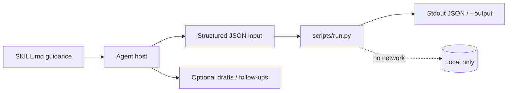
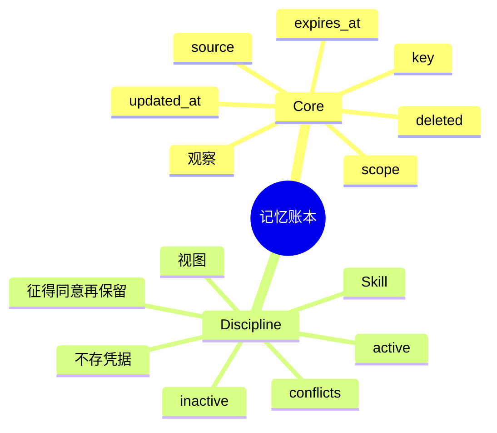

# 记忆账本

[English](README.md) · [中文](README.zh-CN.md) · **v0.2.1**

[](https://github.com/KarmenLoop/skill-memory-ledger/actions/workflows/checks.yml)
[](https://github.com/KarmenLoop/skill-memory-ledger/releases/latest)
[](https://www.python.org/downloads/)
[](LICENSE)
[](docs/COMPATIBILITY.md)

**在指定时刻、指定范围内解析事实——更正、冲突、过期与删除仍然可见。**

一套 Agent Skill，外加本地对账器：带来源的观察记录被解析为活跃键、冲突与非活跃项，彼此分开。 导出（或会议文本、diff、账本、事件日志、JUnit XML）留在本地；辅助程序只用标准库，从不发起网络连接。Skill 层教宿主*何时*准备输入、*如何*陈述结果，以及在用户未授权的副作用前*停在哪里*。

由 [KarmenLoop](https://github.com/KarmenLoop) / [KARMENLOOP](https://karmenloop.com) 维护。当前发布：**[v0.2.1](https://github.com/KarmenLoop/skill-memory-ledger/releases/tag/v0.2.1)**。许可证：**MIT**。


*v0.2.1 真实本地输出渲染图。[examples/expected.json](examples/expected.json) · [图像出处](docs/images/provenance.json)。*

[下载 v0.2.1](https://github.com/KarmenLoop/skill-memory-ledger/releases/tag/v0.2.1) · [英文教程](docs/tutorial.en.md) · [中文教程](docs/tutorial.zh-CN.md) · [输入契约](docs/input.zh-CN.md)

---

## 为什么做这个

聊天记忆常把历史压成一条「事实」。偏好一变，旧值就与新值暗中打架。

记忆账本把召回做成**对账**：同键同范围，后写的更正胜出；同时冲突会显式暴露；过期与删除进入 `inactive`，而不是消失。

Skill 规定账本该装什么（带来源的偏好与决策）——不包括凭据，也不包括自动跨设备同步。

---

## 快照

| | |
|---|---|
| **安装内容** | Skill 树 + `scripts/run.py` 对账器 + `install.py` |
| **运行时** | Python **3.9+**，仅标准库 |
| **网络** | **无** |
| **输入** | UTF-8 JSON：`scope`、`as_of`、`observations[]`（`key`、`value`、`scope`、`source`、`updated_at`，可选 `expires_at` / `deleted`） |
| **输出** | `active` 映射、`conflicts` 映射、带原因的 `inactive` 映射，以及 `scope` |
| **安装宿主** | `codex` · `deepseek` · `grok` · `agents` |
| **包标识** | `karmen-memory-ledger` |
| **许可证** | MIT |

---

## 是 / 不是

| 是 | 不是 |
|---|---|
| 对提交观察做时间点对账 | 数据库服务或向量记忆 SaaS |
| 可见的冲突、过期与墓碑 | 跨设备静默后写覆盖 |
| 带范围、来源与时间戳的键 | 模型权重训练或嵌入库 |
| 离线标准库辅助程序 | 手机与电脑之间的自动同步 |
| Skill 规定可保留内容 | 存储凭据或授予访问的许可 |

---

## 工作方式

两层有意分开：

1. **方法层（`SKILL.md`）** — 何时调用、如何准备诚实输入、交付什么，以及哪些副作用在没有新的用户授权时仍禁止。
2. **确定性辅助程序（`scripts/run.py`）** — 校验 UTF-8 JSON 契约（最大 10 MiB），本地计算，打印到 stdout（或新的 `--output`），非法输入以 `2` 退出。





### 流程

1. **选定**精确 `scope` 与可复现视图的 `as_of` 时间戳。
2. **记录**带稳定键、来源与带偏移 `updated_at` 的观察。更正是更晚的观察；删除使用 `deleted: true`。
3. **运行**对账。检查 `conflicts` 与 `inactive`，不要把一切压成一条无条件事实。
4. **只把审过的结果**写入宿主真实使用的存储。下次只取相关活跃键——不是整段历史倾倒。

### 示例证明什么

在 `project:demo` 范围，后到的更正把 `report_format` 定为 CSV，并保留其来源与时间戳。

退出码 `0` 表示处理完成——不表示业务上「全部通过」。

---

## 快速开始

从 [v0.2.1 发布页](https://github.com/KarmenLoop/skill-memory-ledger/releases/tag/v0.2.1) 下载 `karmen-memory-ledger-v0.2.1.zip` 与对应 `.sha256`，校验哈希后解压。需要 Python 3.9+。

```sh
python3 scripts/run.py --version
python3 scripts/run.py --input examples/input.json
```

期望版本串：`karmen-memory-ledger 0.2.1`。

可选：安装到会扫描 skills 目录的宿主（目标已存在则拒绝）：

```sh
python3 install.py --host agents
# 亦可：--host codex | deepseek | grok
# 或：  --destination /精确/新目录
```

完全可以不借助 AI 宿主直接跑辅助程序。宿主发现与调用方式仍因产品而异——见 [docs/tutorial.zh-CN.md](docs/tutorial.zh-CN.md) 与 [docs/COMPATIBILITY.md](docs/COMPATIBILITY.md)。

管道与版本探测：

```sh
python3 scripts/run.py --input - < examples/input.json
python3 scripts/run.py --version
```

---

## 用在你自己的工作上

准备新载荷前先读 [docs/input.zh-CN.md](docs/input.zh-CN.md)（或 [docs/INPUT.md](docs/INPUT.md)）。

- 在同一时间戳加入冲突值，观察 `conflicts`。
- 换一个 scope，并用 `expires_at` 测过期记录。
- 仅运行辅助程序不会改写任何 AI 账号记忆。
- Skill 中的密钥筛查是小型拒绝列表，不是完整密钥扫描器。

辅助程序不需要模型账号、API 密钥或网络。AI 宿主有自己的数据与权限设置；本 skill 不授予发送、购买、发布或改权限的权力。

---

## 文档地图

| 文档 | 何时使用 |
|---|---|
| [教程（中文）](docs/tutorial.zh-CN.md) · [English](docs/tutorial.en.md) | 下载、安装、练习、升级、卸载 |
| [输入/输出契约（中文）](docs/input.zh-CN.md) · [EN](docs/INPUT.md) | 字段语义与示例 |
| [兼容性](docs/COMPATIBILITY.md) | 宿主安装路径与未验证边界 |
| [验证](docs/VALIDATION.md) | 实际跑过什么 |
| [来源](docs/SOURCES.md) | 设计背后的研究笔记 |
| [变更日志](CHANGELOG.md) | 发布历史 |
| [贡献](CONTRIBUTING.md) · [支持](SUPPORT.md) · [安全](SECURITY.md) | 协作与报告 |

---

## 验证（如实）

基线见 [docs/VALIDATION.md](docs/VALIDATION.md)：2026-10-18 (UTC) · Python 3.9.6 · macOS arm64 (see docs/VALIDATION.md)。

| 检查 | 结果 |
|---|---|
| `python3 scripts/run.py --input examples/input.json` | 退出 0；夹具与实跑输出对齐 |
| `python3 -m unittest discover -s tests -v` | 维护者环境退出 0 |
| `skill-creator` 快速校验 | 元数据通过 |

**未声称：** 每个支持宿主内的已登录对话、在线账号连接器，或 Windows/Linux 宿主 UI 全覆盖。安装在临时目录测过；模型如何解释仍是宿主责任。依赖调用前请确认精确的 `SKILL.md` 已被发现。

CI：[`.github/workflows/checks.yml`](https://github.com/KarmenLoop/skill-memory-ledger/actions/workflows/checks.yml)。

---

## 常见问题

### 一句话：记忆账本是什么？

MIT Skill + 离线对账器：把带来源的观察解析为指定范围与时刻下的活跃、冲突与非活跃映射。

### AI 会自动记住吗？

只有宿主真正存储并在之后供给这些记录时才会。仅运行辅助程序不会改 AI 账号。

### 会跨设备同步吗？

不会。跨设备需要别处的认证同步层；本辅助程序只对一份提交的账本对账。

### 结果写到哪里？

stdout JSON 或新的 `--output` 路径。已有文件保留。

### 凭据能放进账本吗？

不该。Skill 明确排除凭据与执行权限。

### 如何安装？

`python3 install.py --host agents`（或 `codex` / `deepseek` / `grok`）。不覆盖已有目录。

---

## 许可与联系

[MIT](LICENSE)。再分发时请保留许可证与 [声明](NOTICE.md)。

[karmenloop.com](https://karmenloop.com) · [GitHub @KarmenLoop](https://github.com/KarmenLoop) · [info@karmenloop.com](mailto:info@karmenloop.com)

KARMENLOOP Official Team · 上海

<!-- Copyright (C) 2026 KARMENLOOP Official Team
SPDX-License-Identifier: MIT -->
