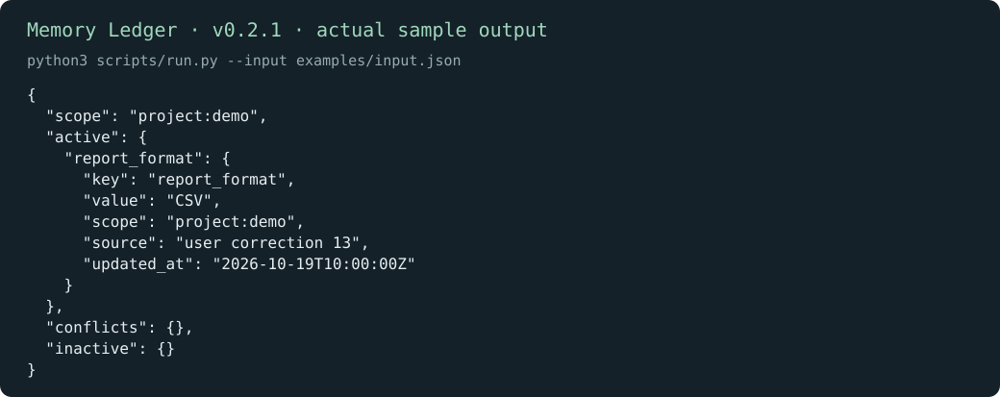

# Memory Ledger · 记忆台账

[English](README.md) | 简体中文

按指定时间和范围整理已保存的事实。更正、冲突、过期和删除都有位置，让使用这些信息的智能体分清当前偏好与旧记录。

[下载 v0.2.1](https://github.com/KarmenLoop/skill-memory-ledger/releases/tag/v0.2.1) · [完整教程](docs/tutorial.zh-CN.md) · [输入参考（英文）](docs/INPUT.md) · [反馈问题](https://github.com/KarmenLoop/skill-memory-ledger/issues)

## 能做什么

在 project:demo 范围内，较新的更正使 report_format 采用 CSV，并保留来源与时间戳。

台账只处理提供的观察记录，不是数据库服务、模型训练系统或自动跨设备同步工具。



*图片来自 v0.2.1 的真实本地输出，采用英文键名；[完整结果](examples/expected.json) · [图片来源记录](docs/images/provenance.json)。*

## 开始使用

在发行页下载 `karmen-memory-ledger-v0.2.1.zip` 与对应 `.sha256` 文件，核对哈希后解压。在解压目录中使用 Python 3.9 或更新版本：

```sh
python3 scripts/run.py --version
python3 scripts/run.py --input examples/input.json
```

预期版本：`karmen-memory-ledger 0.2.1`。在 project:demo 范围内，较新的更正使 report_format 采用 CSV，并保留来源与时间戳。

如果宿主读取 `~/.agents/skills`，可安装完整技能：

```sh
python3 install.py --host agents
```

目标目录已存在时安装器会拒绝覆盖。宿主发现和调用方式可能不同，见[安装与实践教程](docs/tutorial.zh-CN.md)。不使用 AI 宿主也能直接运行本地工具。

## 用于自己的任务

每条记录填写 key、准确 scope、来源和带时区的 updated_at。as_of 用于固定查询时点；需要时设置 expires_at 或 deleted。

加入同一时刻的冲突值，再测试其他范围及过期记录。查看 conflicts 与 inactive，避免把所有观察都压成一个无条件事实。

准备新输入前可查看[字段约定（英文）](docs/INPUT.md)。工具只依赖 Python 标准库，本身不需要模型账号、API 密钥或网络。使用 AI 宿主时，宿主有自己的数据与权限设置。

## 常见问题

**运行后 AI 就会自动记住吗？** 需要宿主明确保存记录，并在之后提供相关结果。单独运行工具不会改变 AI 账号。

**结果保存在哪里？** 默认向终端输出 JSON；使用 `--output` 时只创建新文件，已有输出文件会保留。工具只读取提交的记录和输入约定中明确列出的本地路径。

## 文档与支持

- [下载、安装、配置、练习、升级与卸载](docs/tutorial.zh-CN.md)
- [输入输出约定](docs/INPUT.md)与[兼容性说明](docs/COMPATIBILITY.md)（英文参考）
- [更新记录](CHANGELOG.md)、[参与贡献](CONTRIBUTING.md)、[支持](SUPPORT.md)和[安全反馈](SECURITY.md)

## 许可证

[MIT](LICENSE)。再分发时保留许可证和[声明](NOTICE.md)。由 [KarmenLoop](https://karmenloop.com) 维护。
